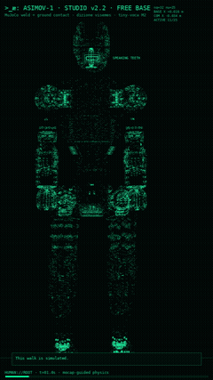

# hermes-ae

**One receipted tool for the Asimov robot studio.**

`hermes-ae` is a Hermes Agent plugin (v2.2.0) that consolidates speech, physics,
visemes, rendering, VLC control, gallery publishing, and a tamper-evident receipt
ledger behind a single tool: `ae`. It produces 9-second, 9:16 studio videos of the
25-DOF Asimov-1 humanoid, driven by real MuJoCo dynamics and phoneme-derived mouth
shapes, and records a `HUMAN://ROOT` receipt for every action.

## Highlights

- **One tool, many operations.** `ae` dispatches through an `op` enum. Built-in ops
  handle status, receipts, chain verification, and direct calls; shortcuts reach
  optional legacy plugins.
- **Two bundled pipelines.**
  - `studio_video` — Studio v2.1: fixed-base physics trace + visemes (the classic
    capture model). Output: `asimov-studio-v2-916.mp4`.
  - `free_walk` — Studio v2.2: mocap-guided floating base with ground contacts,
    where forward motion is solved by MuJoCo rather than prescribed. Output:
    `asimov-free-walk-916.mp4`.
- **Receipts on every action.** A SHA-256 hash chain anchored at `GENESIS` and
  signed `HUMAN://ROOT` is appended for each `ae` call and each finished video.
- **Portable.** All runtime locations are configurable through environment
  variables; the repository ships only manifests and code.

## Requirements

- Hermes Agent with plugin loading support.
- Python 3 with `numpy`, `Pillow`, `mujoco` (MuJoCo 4.0.1 used in capture),
  `onnxruntime`, and the `dizione` phonemizer.
- `ffmpeg` / `ffprobe` for encoding and QC.
- Self-hosted `tiny-voca` voice weights (voices `F2` / `M2`, 24 kHz).
- STL meshes in `HERMES_AE_MESHES` and a writable gallery repo for publishing.
- `git` configured with push access when publishing videos.

Binary STL meshes and finished videos are **not** stored in this repository.

## Install

Copy or symlink this directory into your Hermes plugins folder so that
`HERMES_AE_PLUGINS/hermes-ae/__init__.py` is discoverable, then set the environment
variables you need. See [docs/INSTALL.md](docs/INSTALL.md) for details and the
full variable reference.

## Quick start

```text
ae({"op": "status"})        # version, plugins, shortcuts, receipt-chain head
ae({"op": "ops"})           # list shortcuts and bundled local ops
ae({"op": "verify"})        # validate the receipt hash chain
ae({"op": "receipts", "limit": 10})
ae({"op": "free_walk", "publish": false})
```

More recipes are in [examples/ae_calls.md](examples/ae_calls.md).

## Documentation

- [docs/ARCHITECTURE.md](docs/ARCHITECTURE.md) — how dispatch, pipelines, and the
  model manifests fit together.
- [docs/RECEIPTS.md](docs/RECEIPTS.md) — the `HUMAN://ROOT` hash-chained ledger.
- [docs/INSTALL.md](docs/INSTALL.md) — setup and configuration.
- [examples/ae_calls.md](examples/ae_calls.md) — worked `ae` call examples.
- [CHANGELOG.md](CHANGELOG.md), [THIRD_PARTY_NOTICES.md](THIRD_PARTY_NOTICES.md).

## Published videos

Videos are published to the `gh-pages` branch of the gallery repository and served
from raw URLs of the form:

```text
https://raw.githubusercontent.com/MYaelMendez/MYaelMendez.github.io/gh-pages/<filename>.mp4
```

The two current captures are `asimov-studio-v2-916.mp4` (v2.1) and
`asimov-free-walk-916.mp4` (v2.2).

## Licensing

- Plugin source code: **MIT** — see [LICENSE](LICENSE).
- Asimov-1 model source: [menloresearch/asimov-1](https://github.com/menloresearch/asimov-1),
  licensed **CERN-OHL-S-2.0**. See [THIRD_PARTY_NOTICES.md](THIRD_PARTY_NOTICES.md).

`HUMAN://ROOT` denotes human authority over agent actions; it is an attribution
marker used by the receipt ledger, not a software license.

## Preview



A 9-second mocap-guided MuJoCo walk with dizione visemes and tiny-voca narration.
Full clips and receipts are indexed in [docs/VIDEOS.md](docs/VIDEOS.md).

## Docs

- [Open courses](docs/COURSES.md) — reusable two-voice lesson template
- [tiny-voca primitive](docs/TINY_VOCA.md) — native Hermes TTS with F2/M2 voices
- [Mixture of Harnesses](docs/HARNESSES.md) — plugin vs. harness and the nine governed envelopes
- [The v3.0.0 masterpiece target](docs/MASTERPIECE.md) — the one-command, receipted capstone deliverable
- [Asimov agent body](docs/ASIMOV_AGENT.md) — the visible hermes-agent build
- [Policy-driven locomotion](docs/POLICY_LOCOMOTION.md) — the ONNX gait that replaced the mocap trace
- [æLOCOMOTION package](docs/PACKAGING.md) — the policy-driven gait harness, packed
- [Viewport DOM awareness](docs/VIEWPORT_DOM.md) — read-only CDP projection for the Asimov robot
- [Native head viewport](docs/HEAD_VIEWPORT.md) — four exterior shell zones, tiny-voca fallback, and Pi500 teleop
- [Asimov USD twin](docs/ASIMOV_TWIN.md) — the official robot as a USD digital twin
- [æ Policy](docs/AE_POLICY.md) — the machine-readable authority policy for the Internet of Agents
- [DAO Brain](docs/DAO_BRAIN.md) — policy-gated governance for the native Asimov head viewport
- [Menlo SDK mapping](docs/MENLO_SDK_MAPPING.md) — how OpenSourceWare sits above the official SDK
- [æ Robot Verbs](docs/AE_ROBOT_VERBS.md) — governed wrappers over official Menlo SDK verbs
- [mobility.foundation](docs/MOBILITY_FOUNDATION.md) — canonical public home for Asimov Agent mobility
- [Sovereign projection](docs/SOVEREIGN_PROJECTION.md) — first-principles bundle refactor
